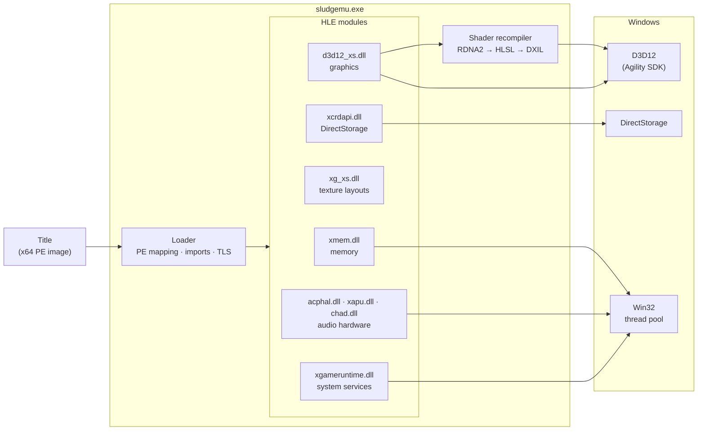

<div align="center">


### Xbox Series X|S compatibility layer for Windows

sludgemu executes the console's x64 code natively and reimplements the console platform around it. No CPU emulation is involved.

<br>


**[Architecture](#architecture)** ·
**[Status](#status)** ·
**[Building](#building)** ·
**[Usage](#usage)** ·
**[Diagnostics](#diagnostics)** ·
**[Technical details](#technical-details)** ·
**[Contributing](#contributing)**

</div>

---

> [!WARNING]
> **sludgemu is in early development.** The loader, memory model, graphics translation, shader
> recompiler, DirectStorage and audio subsystems are implemented and under active development.
> Many console APIs remain logging stubs, and no compatibility list is maintained. Titles may fail
> at startup, hang or crash. No title should currently be considered playable.

> [!IMPORTANT]
> This repository contains **no Microsoft GDK code or headers** and **no title code or data**. Use
> requires a legally obtained, decrypted title package. Issues or pull requests that contain GDK
> material, title files, or links to either will be closed.

## Architecture

An Xbox Series X|S title is an **x64 Windows PE image** built against the console edition of the
Microsoft GDK. The console CPU is a Zen 2 processor, and title code is standard MSVC-compiled x64.
The differences from a PC lie in the surrounding platform: the memory model, the GPU and driver
stack, the storage and audio hardware, and the system services.

sludgemu is therefore not an emulator in the conventional sense. It **maps the title directly into
its own process**, executes its code at native speed, and provides its own implementation of every
console-specific DLL the title imports. Each of these implementations is referred to as an
**HLE module**.



| Console component | sludgemu implementation |
|---|---|
| **CPU** (Zen 2) | Title code executes natively. AMD-specific instructions (`CLZERO`, `MONITORX`/`MWAITX`, SSE4a `EXTRQ`/`INSERTQ`, `CLWB`) are handled by a fault handler on hosts that do not support them. |
| **Unified memory** | The console's 64 KiB page-frame model is reproduced using Windows placeholders and `MapViewOfFile3`, allowing a single frame to be mapped at multiple addresses as on the console. |
| **GPU** (RDNA2) | The console D3D12 runtime is implemented on desktop D3D12. RDNA2 shader binaries are recompiled to DXIL at runtime, and the GPU accesses title memory in place without copying. |
| **Texture layouts** | Console swizzle modes and mip layouts are reproduced exactly using AMD's addrlib configured for the console GPU. Textures are detiled on the GPU. |
| **Storage** | Console DirectStorage is backed by desktop DirectStorage. The console's hardware decoders (zlib and **BCPack**) are implemented as decoder threads attached to DirectStorage. |
| **Audio** | The audio processor is reimplemented: the APU heap, audio control processor timing and messaging, XMA and Opus decoding, and the DSP (FFT and convolution reverb). |
| **System services** | The Game Runtime is implemented, including task queues, async blocks, users, package, store, game saves, system information and frame pacing. |
| **Presentation** | Titles render to a standard resizable desktop window with borderless fullscreen support. Scene and HUD planes are composited and letterboxed to 16:9. |

## Status

| Area | State | Notes |
|---|---|---|
| PE loader, imports, TLS | Working | Maps titles at their preferred base, binds imports and runs the title's CRT |
| Console memory model | Working | Page frames, aliasing, commit on demand and the graphics address window |
| CPU instruction compatibility | Working | Fault-handler fallbacks for AMD-specific instructions |
| Console D3D12 runtime | Partial | Devices, queues, command lists, descriptors, resources, fences and pipelines |
| Shader recompiler | Partial | Translation and compilation run on worker threads. Draws are skipped until their programs are ready. |
| Texture layouts and detiling | Working | addrlib-exact layouts for both Series X and Series S |
| DirectStorage | Partial | Requests, status arrays, fences, and zlib and BCPack decoding |
| Audio | Partial | XMA, Opus and DSP are functional. SHAPE flowgraphs complete without processing. |
| Game Runtime | Partial | Core services are implemented. Unimplemented methods return `E_NOTIMPL` and log their name. |
| Ray tracing | Not started | Acceleration structure sizes are obtained from desktop DXR, but builds are not yet recorded |
| Input | Not started | Not yet implemented |

## Building

### Requirements

| | |
|---|---|
| **Operating system** | Windows 10 or 11, x64 |
| **Compiler** | Visual Studio 2022 with the *Desktop development with C++* workload. Only MSVC is supported, as the title ABI is MSVC x64. |
| **Build system** | CMake 3.24 or later. Ninja is optional. |
| **Network access** | Required for the initial configure step, during which dependencies are downloaded. No dependencies are vendored. |

### Build steps

```powershell
cmake --preset vs2022
cmake --build --preset vs2022-release     # or vs2022-debug
```

Binaries are written to `build/vs2022/bin/<Config>/`. The release preset builds the
`RelWithDebInfo` configuration.

<details>
<summary><b>Building with Ninja</b></summary>

<br>

Run the following from an *x64 Native Tools* or *Developer PowerShell for VS 2022* prompt:

```powershell
cmake --preset ninja-release              # or ninja-debug
cmake --build --preset ninja-release
```

</details>

<details>
<summary><b>Dependencies</b></summary>

<br>

| Dependency | Version | Purpose |
|---|---|---|
| D3D12 Agility SDK | 1.620.2 | Desktop D3D12 runtime targeted by the translation layer, independent of the OS build |
| DirectStorage | 1.3.0 | Backend for console DirectStorage |
| DirectX Shader Compiler | 1.9.2609.5 | Compiles sludgemu's own shaders at build time and translated title shaders at runtime |
| libdeflate | 1.26 | zlib decompression for DirectStorage requests |
| Opus | 1.5.2 | Opus decoding for XApu |
| AMD addrlib (Mesa) | | Console texture layouts |

NuGet packages are verified against SHA-256 hashes. The build copies the following runtime DLLs
alongside `sludgemu.exe`: `dstorage.dll`, `dstoragecore.dll`, `dxcompiler.dll`, `dxil.dll` and
`D3D12\D3D12Core.dll`. These files must remain together when the build output is relocated.

</details>

<details>
<summary><b>Coding requirements</b></summary>

<br>

- C++20, compiled **without exceptions or RTTI** (`/EHs-c- /GR-`).
- **Static CRT**, so that sludgemu's CRT state is never shared with the title's CRT DLLs.
- **No implicit TLS in `sludgemu.exe`** (no `thread_local`, no `/Zc:threadSafeInit`, no
  incremental linking), because the title must own TLS slot 0. Use `TlsAlloc` slots instead. This
  is enforced by a startup check; see [the TLS notes](docs/ARCHITECTURE.md#tls) for details.
- Diagnostic code paths must never acquire the loader lock.
- Code must be formatted with the repository's [`.clang-format`](.clang-format).

</details>

## Usage

```
sludgemu.exe [options] <package directory | title exe> [-- title arguments]
```

The target may be an extracted package directory or the title's executable. Arguments following
`--`, or following the first unrecognised positional argument, are passed through to the title.

The title runs in its own window, in the same manner as a native application.

| Key | Action |
|---|---|
| <kbd>F11</kbd> or <kbd>Alt</kbd> + <kbd>Enter</kbd> | Toggle borderless fullscreen |
| Close the window | Exit |

### Console model selection

Titles adjust their memory budget, render resolution and quality settings to the console model they
detect. sludgemu presents itself as a **Series X** only on hosts with **at least 24 GB of RAM and a
10 GB GPU**, and as the less demanding **Series S** otherwise. The `--model` option overrides this
selection.

### Command-line options

| Option | Description |
|---|---|
| `--model=series-x\|series-s` | Console model to present (default: selected from host RAM and VRAM) |
| `--console` | Open a console window displaying the live log |
| `--log-level=LEVEL` | `trace`, `debug`, `info` (default), `warn` or `error` |
| `--gpu-warp` | Render with WARP, the software rasterizer, instead of the hardware GPU |
| `--gpu-debug` | Enable the D3D12 debug layer |
| `--gpu-serialize` | Wait for the GPU after every title submission (timing diagnostics) |
| `--frame-stats` | Log presents per second and the longest frame interval once per second |
| `--break-on-stub` | Break into an attached debugger when the title calls an unimplemented import |
| `--dump-threads-after=N` | Log a backtrace of every thread every N seconds (hang diagnostics) |
| `--watch-write=SPEC` | Set a hardware watchpoint that logs every write (value and backtrace) to an 8-byte location: `module.dll+0xRVA`, `0xADDRESS` or `ldrentry:N` |
| `--trace-exec=SPEC[,...]` | Log register state whenever any of up to three code locations executes |

### Output files

| Path | Contents |
|---|---|
| `sludgemu.log`, alongside the executable | Complete session log |
| `sludgemu_crash.dmp`, alongside the executable | Minidump written on a crash |
| `%LOCALAPPDATA%\sludgemu\<title id>\PersistentLocalStorage\` | The title's persistent local storage |

## Diagnostics

The following environment variables enable additional debugging features:

| Variable | Effect |
|---|---|
| `SLUDGE_SHADER_DUMP=<dir>` | Write each title shader program (raw code, translated HLSL, and the error if translation fails) to `<dir>` |
| `SLUDGE_CAPTURE_FRAMES=<first>[,<count>]` | Save presented frames, beginning at frame `<first>` |
| `SLUDGE_CAPTURE_DIR=<dir>` | Output directory for captured frames (default: the current directory) |
| `SLUDGE_RENDERDOC_FRAME=<n>[,<n>...]` | Trigger RenderDoc captures on the specified frames when running under RenderDoc |
| `SLUDGE_TRACE_TEXTURES=<W>x<H>` | Trace creation and synchronisation of textures with the given dimensions |
| `SLUDGE_TRACE_TEXTURES_DUMP=<dir>` | Additionally dump traced textures to `<dir>` |
| `SLUDGE_TRACE_SKIP=N` | With `--trace-exec`: skip the first N hits |
| `SLUDGE_TRACE_DUMP=BYTES` | With `--trace-exec`: additionally dump memory at pointer registers |

### Debugging conventions

- Addresses within title images are logged as `module+rva [preferred-base address]` so they can be
  used directly in a disassembler.
- Each call to an unimplemented import logs `module!function called from <address>` and returns 0,
  ensuring that no missing functionality goes unreported.
- Title assertions (breakpoints) are logged as first-chance exceptions with a backtrace, because
  titles install their own unhandled-exception filters.
- Graphics issues should be investigated with a frame capture (RenderDoc or Nsight Graphics).

## Technical details

<details>
<summary><b>Loader</b></summary>

<br>

Titles are not loaded through the Windows loader, as sludgemu requires full control over import
resolution and the address space. Loading proceeds as follows:

1. **Mapping.** Headers and sections are mapped at the image's preferred base, with relocation only
   as a fallback, so that addresses match those in a disassembler.
2. **Unwind registration.** `.pdata` is registered with `RtlAddFunctionTable` so that SEH, C++
   exceptions and stack walks function correctly.
3. **Implicit TLS.** Compilers hard-code TLS index 0 for an executable's thread-local variables, so
   the title must own slot 0. The implicit TLS of `sludgemu.exe` consists solely of a 64 KiB
   reserved block that is handed over to the title, and a TLS callback copies the title's template
   into it on every thread.
4. **Import binding.** Each imported DLL is resolved to one of the following:
   - an **HLE module**, if sludgemu implements it. Exports not yet implemented become logging stubs.
   - the **title's own DLL** from the package. It is loaded through the native loader if it has no
     console-specific imports, and mapped manually otherwise. The VC++ runtime is always taken from
     the host.
   - a **host DLL** from System32, with individual functions replaced by *host overrides* where
     console behaviour differs (`LoadLibraryExW`, `GetProcAddress`, `CreateWindowExA`, and file,
     memory and registry functions, among others).
5. **Finalisation.** Section protections are applied and DLL entry points are run, followed by the
   title's TLS callbacks and entry point.

Titles are presented with the console's CPU topology: 7 SMT cores (14 hardware threads) across two
core complexes. Affinity requests are recorded but not applied, as the host scheduler places threads
more effectively on hybrid CPUs than a fixed mapping would.

Further reading: [docs/ARCHITECTURE.md](docs/ARCHITECTURE.md)

</details>

<details>
<summary><b>Memory</b></summary>

<br>

Physical memory is divided into **64 KiB page frames**, matching both the console page size and the
Windows view granularity. Frames are backed by 256 MiB pagefile sections ("chunks") that are created
on demand, so the commit charge reflects actual usage. Freed frames return their memory to the
operating system and are zeroed on reuse.

Ranges reserved for physical mapping are Win32 **placeholders**, into which frames are mapped with
`MapViewOfFile3`. This provides true aliasing: a single frame can be mapped at multiple addresses,
as on the console.

Frame numbers serve only as identifiers until first mapped. Deferred binding allows each 256 MiB
slice of a range to claim a free chunk and arrange its pages in address order, so memory that is
contiguous to the title is also contiguous in RAM; the GPU layer relies on this property. Before
committing additional memory, sludgemu checks the system's remaining commit and terminates the title
rather than allowing it to exhaust system-wide commit.

</details>

<details>
<summary><b>Graphics</b></summary>

<br>

Console D3D12 objects are plain structures with function tables. Every entry is implemented by
sludgemu and targets a desktop D3D12 device provided by the **Agility SDK**.

**Unified memory without copies.** The console GPU shares memory with the CPU through page tables.
sludgemu provides the desktop GPU with two mechanisms for accessing title memory, selected per page:

- **Windows:** desktop buffers placed on heaps opened directly over the title's own pages
  (`OpenExistingHeapFromAddress1`). The GPU reads and writes CPU memory in place, with cache-line
  coherence, as on the console.
- **Page tables:** reserved 4 GiB buffer segments, overlapping at 2 GiB intervals, whose pages map
  to tiles of video memory. This mechanism supports arbitrary frame layouts, including aliases and
  non-contiguous pools. Write watches and page protection maintain coherence between CPU and GPU
  copies.

**Textures** reside in title memory in the console GPU's native layout: RDNA2 swizzle modes,
smallest-first mip chains and compression metadata planes. Titles size and populate textures based
on this layout, so it must be reproduced exactly. `gpu/console_layout` computes it using addrlib
configured for the console GPU (Series X and Series S differ in memory pipes and packers). A compute
shader then detiles textures directly from title memory, so the CPU never accesses texel data.
Streamed textures are reserved resources whose tiles are backed by VRAM only while the title has the
corresponding memory mapped.

**Descriptor heaps** reside in title memory, where handles are plain addresses, and are mirrored slot
for slot by desktop heaps.

**Frame pacing** follows the console model: the title specifies an interval and period and waits for
origin events. A scheduler thread maintains a virtual display timeline, and presented frames flip at
its vertical blanking intervals.

Further reading: [docs/GPU_MEMORY.md](docs/GPU_MEMORY.md)

</details>

<details>
<summary><b>Shader recompilation</b></summary>

<br>

Console titles ship **compiled GPU machine code** rather than DXBC or DXIL. sludgemu decodes RDNA2
(gfx10.3) instructions, translates each program to HLSL, and compiles the result to DXIL with DXC on
worker threads. Results are cached by program code and translation inputs.

The translation model is as follows:

- Each register is represented as a 32-bit HLSL variable. Each desktop thread executes the console
  program for a single console lane, and scalar registers hold the same value across all threads.
- Lane masks (`EXEC`, `VCC` and compare results) hold the current lane's bit broadcast to all ones
  or all zeros. Bitwise mask operations therefore work unchanged, while whole-mask operations use
  wave intrinsics.
- Scalar branches are uniform, so desktop waves remain converged.
- Console user SGPRs are supplied through a root constant block. Descriptor tables hold byte offsets
  into the desktop heaps, so the console code's own descriptor address arithmetic remains valid.
- Vertex fetches are converted to input-assembler inputs.

Draws whose programs are not yet ready are skipped rather than stalling the title.
`SLUDGE_SHADER_DUMP` and `shader_tool` can be used together to analyse programs offline.

</details>

<details>
<summary><b>DirectStorage and BCPack</b></summary>

<br>

The console DirectStorage API (`xcrdapi.dll`) is the predecessor of the desktop API, so each console
queue wraps a desktop counterpart and requests are translated at enqueue time.

The console provides **hardware decoders** for zlib and **BCPack** and supports destination
swizzling, none of which are available on desktop. Requests requiring these features are assigned a
custom compression format that encodes the required operations, and DirectStorage dispatches them
to sludgemu's decoder threads through its custom decompression queue. Failures are reported in order
through DirectStorage's own status arrays.

BCPack is a lossless codec for BCn texture blocks. It re-expresses each block as small symbols
(endpoint deltas, index deltas and reference distances) and entropy-codes them using interleaved
rANS lanes. sludgemu includes a clean-room decoder supporting BC1 through BC7.

Further reading: [docs/BCPACK.md](docs/BCPACK.md)

</details>

<details>
<summary><b>Audio</b></summary>

<br>

Console titles process audio on dedicated hardware, programmed through context arrays in APU memory
and driven by an audio control processor (ACP).

- **`acphal.dll`** provides the APU heap and context arrays. The ACP maintains timing, issuing frame
  messages every 256 samples at 48 kHz, completes commands and drives the decoders.
- **XMA** decoding writes into the title's output rings as they drain, which is the mechanism titles
  use for pacing. The decoder is derived from FFmpeg's WMA Pro decoder.
- **`xapu.dll`** provides XMA and **Opus** decoding.
- **`chad.dll`** implements the DSP, executing FFTs and uniformly partitioned overlap-save
  convolution reverb in order on a worker thread, consistent with the hardware.
- **SHAPE** flowgraphs (sample rate conversion, EQ and filters) currently complete without
  processing. Titles tested to date use the hardware only for XMA and perform mixing on the CPU.

</details>

<details>
<summary><b>Game Runtime and file system</b></summary>

<br>

Titles access `xgameruntime.dll` through statically linked thunks. Each flat API function
(`XUserAddAsync`, `XTaskQueueCreate`, and so on) calls `QueryApiImpl(provider, iid)` to obtain an
interface and invokes a single vtable method. sludgemu describes each vtable as a provider, a set of
interface IDs and a slot table. Unimplemented methods are named logging stubs that return
`E_NOTIMPL`. Task queues and async blocks run natively on the Windows thread pool.

On the console, the package is mounted at `G:\`. File overrides and DirectStorage translate these
paths to the package directory and normalise path separators, since titles construct paths such as
`G://settings/`.

</details>

## Tests and tools

**Unit tests** cover the platform-independent components: the memory model, texture layouts,
BCPack, XMA decoding, XApu and the DSP.

```powershell
ctest --test-dir build/vs2022 -C RelWithDebInfo
```

**`shader_tool`** analyses console shader code, typically from a `SLUDGE_SHADER_DUMP` directory:

```
shader_tool disasm <code.bin>                      disassemble raw GPU code
shader_tool stats <dir> [name filter]              instruction statistics; lists undecodable instructions
shader_tool translate <dir> <pipeline> <vs|ps>     translate one stage of a dumped pipeline to HLSL
shader_tool translate-all <dir> <out dir>          translate every unique program and summarise failures
```

## Project layout

```
sludgemu/
├── src/
│   ├── main.cpp          entry point and command line
│   ├── loader/           PE mapping, imports, TLS, stubs, crash reports, diagnostics
│   ├── core/             title metadata, memory model, console profile, CPU compat, G:\ VFS
│   ├── hle/              console system DLLs implemented by sludgemu
│   │   ├── d3d12/        console D3D12 runtime (d3d12_xs.dll), BVH builder
│   │   ├── xg/           texture layout library (xg_xs.dll)
│   │   ├── xmem/         title memory management (xmem.dll)
│   │   ├── audio/        AcpHal, XApu, XMA, DSP (chad.dll)
│   │   ├── dstorage/     DirectStorage (xcrdapi.dll), BCPack decoder
│   │   ├── xgameruntime/ task queues, async, users, saves, package, store, system
│   │   └── kernel/       host overrides: modules, memory, files, registry, CPU
│   ├── gpu/              windows, page tables, tile pools, detiling, presentation
│   ├── shader/           RDNA2 decoder and disassembler, HLSL translator
│   ├── platform/         desktop window management
│   └── common/           logging, strings, shared types
├── tests/                unit tests
├── tools/                shader_tool
├── cmake/                dependency fetch helpers (NuGet, addrlib)
└── docs/                 design notes
```

## Documentation

| Document | Scope |
|---|---|
| [ARCHITECTURE.md](docs/ARCHITECTURE.md) | Process model, loader, TLS, CPU topology, memory, graphics, file system, Game Runtime and debugging conventions |
| [GPU_MEMORY.md](docs/GPU_MEMORY.md) | GPU access to title memory through windows and page tables, coherence and textures |
| [BCPACK.md](docs/BCPACK.md) | The BCPack stream format: lanes, rANS and reconstruction of BC1–BC7 blocks |

## FAQ

<details>
<summary><b>Is sludgemu an emulator?</b></summary>

<br>

Not in the conventional sense. There is no CPU emulation and no recompilation of the title's x64
code, which executes natively. sludgemu is a compatibility layer, comparable in approach to Wine or
Proton: it implements the console-specific platform APIs on top of Windows.

</details>

<details>
<summary><b>Can titles be played with sludgemu?</b></summary>

<br>

Not at present. See [Status](#status) for the current state of each subsystem.

</details>

<details>
<summary><b>How are titles obtained?</b></summary>

<br>

Titles must be obtained from your own console and legally purchased software. sludgemu does not
provide, link to, or assist in obtaining titles, keys or decrypted packages. Issues requesting them
will be closed.

</details>

<details>
<summary><b>Is Linux or Steam Deck supported?</b></summary>

<br>

sludgemu targets Windows. Titles are Windows PE images that depend on Win32, so running under Wine
or Proton may be possible in principle, but it has not been tested and is not supported.

</details>

<details>
<summary><b>Why are the memory requirements high?</b></summary>

<br>

Titles determine their memory usage from the detected console model, and the Series X provides a
large budget. On hosts below the Series X threshold, sludgemu presents as a Series S, for which
titles use a smaller memory budget.

</details>

## Contributing

Bug reports and patches are welcome.

**Reporting a bug**

1. Reproduce the issue with `--console --log-level=debug` and attach `sludgemu.log`. If the title
   crashed, also attach `sludgemu_crash.dmp`.
2. Describe the host system: CPU, GPU and driver version, RAM, Windows build, and the console model
   selected by sludgemu.
3. **Do not** attach or link title files, decrypted packages or GDK material.

**Submitting a patch**

- Follow `.clang-format` and the [coding requirements](#building).
- Add a unit test in `tests/` for platform-independent code.
- For graphics changes, include a frame capture or before-and-after screenshots.

## Third-party code

The XMA decoder is derived from [FFmpeg](https://ffmpeg.org/) and retains its **LGPL-2.1-or-later**
license. libdeflate, Opus, AMD addrlib, the D3D12 Agility SDK, DirectStorage and DXC are downloaded
at build time under their respective licenses. See [THIRD_PARTY.md](THIRD_PARTY.md) for the complete
list.

---

<div align="center">
<sub>
Xbox, Xbox Series X|S, DirectX and DirectStorage are trademarks of Microsoft Corporation.<br>
sludgemu is not affiliated with or endorsed by Microsoft.
</sub>
</div>
